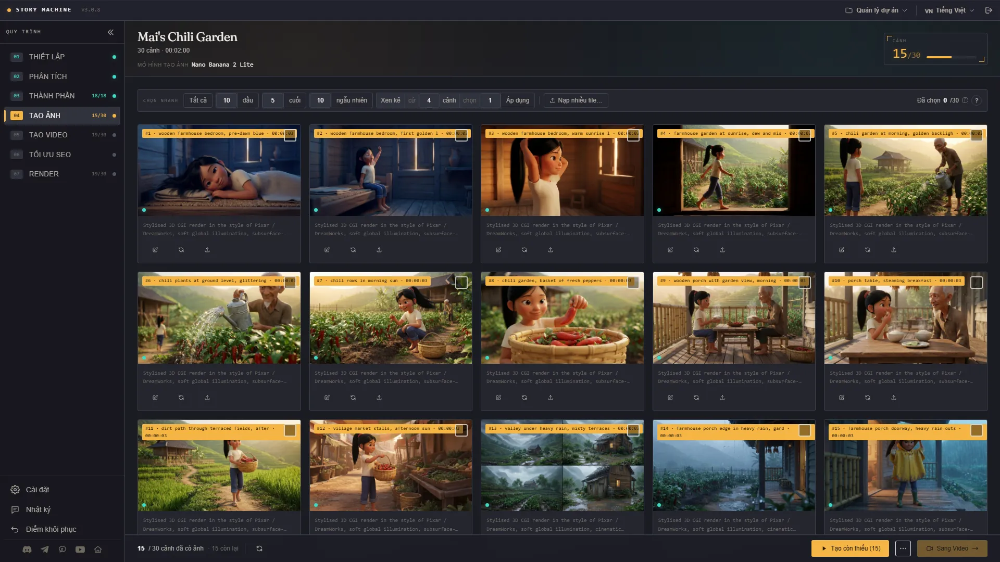
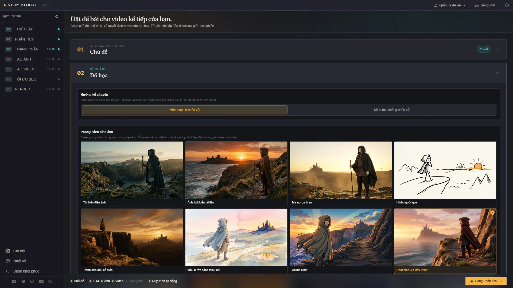
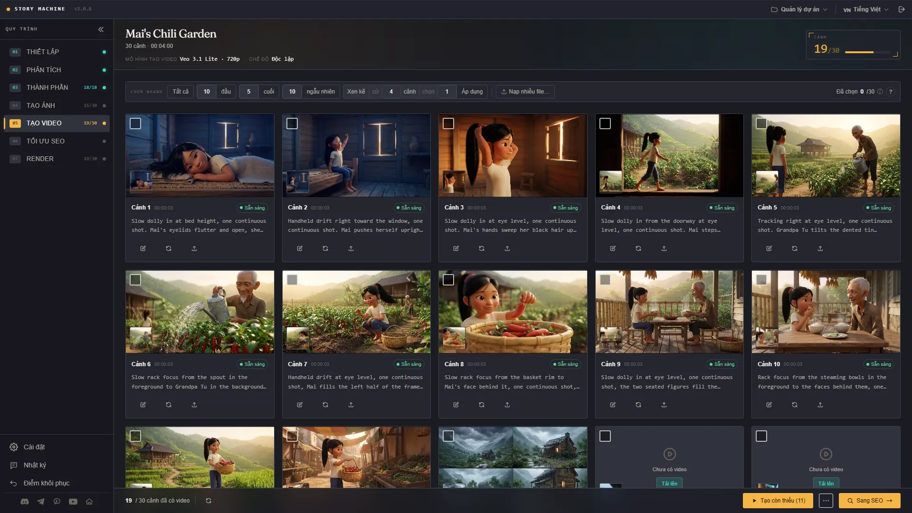
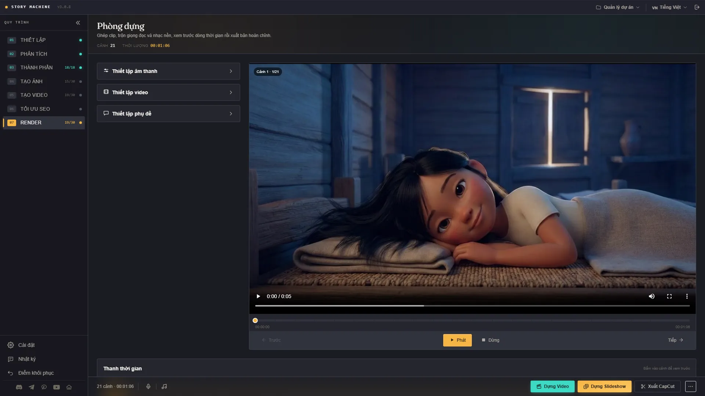

<h1 align="center">G-Labs Story Machine</h1>

<p align="center"><b>Ứng dụng desktop biến một chủ đề, một kịch bản hay một file phụ đề thành video phong cách phim tài liệu: AI viết và lên cảnh, G-Labs Studio tạo ảnh và video, còn bạn duyệt từng bước trước khi render bản cuối.</b></p>

<p align="center">
  <a href="README.md">English</a> ·
  <b>Tiếng Việt</b>
</p>

<p align="center">
  <a href="https://github.com/duckmartians/G-Labs-Story-Machine/releases/latest/download/G-Labs-Story-Machine-setup.exe"></a>&nbsp;
  <a href="https://github.com/duckmartians/G-Labs-Story-Machine/releases/latest/download/G-Labs-Story-Machine-mac-arm64.dmg"></a>&nbsp;
  <a href="https://github.com/duckmartians/G-Labs-Story-Machine/releases/latest/download/G-Labs-Story-Machine-mac-intel.dmg"></a>
</p>

---

## Cài đặt

### Bước 1 - Chọn đúng bản cho máy của bạn

Tải bản mới nhất từ **[Releases](https://github.com/duckmartians/G-Labs-Story-Machine/releases/latest)**, rồi chọn tệp theo đúng máy:

| Máy của bạn | Tải tệp | Ghi chú |
|---|---|---|
| 🪟 **Windows 10/11 (64-bit)** | [`G-Labs-Story-Machine-setup.exe`](https://github.com/duckmartians/G-Labs-Story-Machine/releases/latest/download/G-Labs-Story-Machine-setup.exe) | Trình cài đặt cho mọi PC Windows |
| 🍎 **Mac chip Apple (M1/M2/M3/M4)** | [`G-Labs-Story-Machine-mac-arm64.dmg`](https://github.com/duckmartians/G-Labs-Story-Machine/releases/latest/download/G-Labs-Story-Machine-mac-arm64.dmg) | macOS 12 trở lên |
| 🍎 **Mac chip Intel** | [`G-Labs-Story-Machine-mac-intel.dmg`](https://github.com/duckmartians/G-Labs-Story-Machine/releases/latest/download/G-Labs-Story-Machine-mac-intel.dmg) | Mac đời cũ |

**Không chắc Mac của bạn chip gì?** Bấm biểu tượng  ở góc trên bên trái → **About This Mac**:
- Có dòng **Chip** ghi "Apple M1 / M2 / M3…" → tải bản **arm64**.
- Có dòng **Processor** ghi "Intel…" → tải bản **intel**.

> Tải nhầm bản **Intel** cho máy chip Apple thì vẫn chạy được (qua Rosetta, chậm hơn); còn tải nhầm bản **arm64** cho máy Intel sẽ **không mở được**. Nên chọn đúng.

### Bước 2 - Cài đặt

<details open>
<summary><b>🪟 Trên Windows</b></summary>

1. Mở tệp **`G-Labs-Story-Machine-setup.exe`** vừa tải.
2. Bộ cài đã ký số, nhà phát hành **DUCKMARTIANS**. Nếu bản mới vẫn hiện bảng **"Windows protected your PC"** (SmartScreen), kiểm tra nhà phát hành là DUCKMARTIANS rồi bấm **More info** → **Run anyway**.
3. Làm theo trình cài đặt - giữ thư mục mặc định hoặc chọn thư mục khác. Lối tắt trên Desktop và Start Menu được tạo sẵn.
4. Mở **G-Labs Story Machine** từ **Start Menu** hoặc lối tắt trên **Desktop**.

</details>

<details open>
<summary><b>🍎 Trên macOS</b></summary>

1. Mở tệp **`.dmg`** vừa tải, rồi **kéo biểu tượng G-Labs Story Machine thả vào thư mục Applications**.
2. Vào **Applications**, **bấm chuột phải** (hoặc giữ Control rồi bấm) lên **G-Labs Story Machine** → chọn **Open** → bấm **Open** lần nữa ở hộp xác nhận. *(App chưa được Apple ký nên phải mở kiểu này ở **lần đầu**; những lần sau mở bình thường như mọi app.)*
3. Nếu macOS báo **"bị hỏng / không thể mở"** hoặc không thấy nút Open, mở **Terminal** và dán lệnh sau rồi Enter:
   ```bash
   xattr -dr com.apple.quarantine "/Applications/G-Labs Story Machine.app"
   ```
   Sau đó mở lại app.

</details>

FFmpeg đã đóng gói sẵn trong cả hai bản - không cần cài thêm gì.

### Bước 3 - Đăng nhập (tặng kèm gói MAX của G-Labs)

**Story Machine không bán riêng.** App mở cho **tài khoản của bạn có gói MAX của G-Labs Studio còn hạn**: đăng nhập Google bằng chính tài khoản đó, máy chủ bản quyền kiểm tra gói mỗi lần. Gói MAX mua qua G-Labs Studio, Auto Flow hay Auto Vibes đều được, vì gói Max của tiện ích đã gồm G-Labs Studio gói Max. Nếu tài khoản chưa có MAX, app hiện **"Cần gói MAX"** - gia hạn hoặc nâng cấp rồi bấm **Thử lại**.

- Mọi chế độ, phong cách và tính năng đều mở cho tài khoản có gói MAX còn hạn.
- App cần Internet để đăng nhập và nhận bộ prompt, và phải kiểm tra lại gói ít nhất mỗi **72 giờ**. Hết hạn gói thì app khoá lại; dự án trên máy vẫn giữ nguyên.

Ứng dụng **tự cập nhật**: nó kiểm tra GitHub Releases và tải bản mới ngay trong app - trên Windows nó chạy trình cài đặt mới, trên macOS nó mở tệp `.dmg` mới để bạn kéo vào Applications.

### Cần chuẩn bị thêm

Story Machine là bộ điều phối, không tự tạo ảnh/video/giọng. Trước dự án đầu tiên, bạn cần:

- **Một nhà cung cấp LLM** - Claude CLI, Antigravity CLI, Codex CLI (đã đăng nhập trên máy) hoặc 9Router.
- **[G-Labs Studio](https://github.com/duckmartians/G-Labs-Studio)** đang chạy với Webhook API - để tạo ảnh và video.
- **G-Labs Voiceover** hoặc **G-Labs Voice Studio** - để đọc lời bình (không cần nếu bạn bắt đầu từ file `.srt` hoặc nạp file thuyết minh của mình).

---

## Lần chạy đầu tiên

1. **Mở ứng dụng và đăng nhập bằng Google** với tài khoản có gói MAX của G-Labs Studio.
2. **Mở Cài đặt** (thanh bên trái) và nối công cụ: chọn nhà cung cấp LLM, rồi dán địa chỉ webhook + API key của G-Labs Studio (ảnh/video) và của Voiceover hoặc Voice Studio (giọng đọc).
3. **Đặt đề bài ở trang Thiết lập**: chọn cách bắt đầu (chủ đề, kịch bản, phụ đề hoặc storyboard), rồi tỉ lệ khung, thời lượng, ngôn ngữ đầu ra, giọng điệu và phong cách ảnh.
4. **Đi qua từng trang** - ví dụ với kịch bản: Giọng đọc → Phân tích → Thành phần → Tạo ảnh → Tạo video → Tối ưu SEO → Render. Ở mỗi trang bạn sửa, tạo lại hoặc nạp file của mình trước khi sang bước sau; hoặc bật **chạy tự động** để app đi hết các bước.
5. **Render** ra MP4 hoàn chỉnh (video hoặc slideshow), hoặc **Xuất CapCut** để chỉnh tay.

---

## Tính năng



- **Bốn cách bắt đầu** - **viết kịch bản từ chủ đề** (AI gợi ý ý tưởng, góc khai thác, logline rồi viết kịch bản, xong chuyển sang làm video), từ **kịch bản** của bạn (tự chia câu và đọc thành giọng), từ **phụ đề** `.srt` (mốc thời gian của file quyết định từng cảnh, không cần tạo giọng), hoặc từ **storyboard** - kịch bản thoại, nhân vật nhất quán bằng ảnh tham chiếu.
- **Hai chế độ chạy** - **Chất lượng cao** (qua ảnh từng cảnh) và **Tạo nhanh** (thẳng chữ → video, bỏ bước ảnh; nhanh, tiết kiệm).
- **Mỗi bước một trang** - từng bước của quy trình là một trang riêng để bạn xem lại, sửa, tạo lại hoặc nạp ảnh/clip của mình trước khi đi tiếp. Hoặc bật **chạy tự động** từ đầu đến cuối.
- **Nhân vật nhất quán** - trang **Thành phần** vẽ ảnh tham chiếu cho nhân vật, bối cảnh, đạo cụ; mỗi cảnh tự gửi kèm đúng ảnh của thứ xuất hiện trong cảnh đó, đúng cả khi nhiều nhân vật có tên gần giống nhau.
- **Trang phục theo cảnh** - AI chia bộ đồ cho từng cảnh (ngày mới, trời mưa, đi làm, lễ hội...) và vẽ mỗi bộ bằng cách sửa trên ảnh gốc của nhân vật, nên gương mặt giữ nguyên.
- **Hai hướng dựng hình** - có nhân vật xuất hiện, hoặc minh hoạ không người (đồ vật, khung cảnh, ánh sáng).
- **61 phong cách ảnh mẫu** - từ phim tài liệu, hoạt hình 3D, màu nước đến 11 kiểu người que (hoạt hình lịch sử, truyện sinh tồn, amber noir, tiền sử...); hoặc tự mô tả phong cách rồi lưu lại dùng sau.
- **Dịch & biên tập** - dịch hoặc trau chuốt kịch bản/phụ đề bằng LLM trước khi sản xuất, chuyển qua lại bản gốc ↔ bản dịch.
- **Giọng đọc, nhạc nền & phòng dựng** - thanh thời gian, tự hạ nhạc nền khi có lời, hiện/tắt dần, khớp video với giọng (giữ khung cuối, lặp hoặc làm chậm), phụ đề chèn vào hình; dựng video hoặc slideshow có lia/phóng, hoặc xuất draft CapCut.
- **Tối ưu SEO** - tiêu đề, mô tả, tag và ý tưởng ảnh bìa cho YouTube.
- **Điểm khôi phục** - quay về một trạng thái trước của dự án; trước khi quay về app tạo một điểm mới, nên thao tác này cũng lùi lại được.
- **16 ngôn ngữ giao diện** - English, Tiếng Việt, हिन्दी, Türkçe, Português, 简体中文, اردو, বাংলা, Русский, Español, ไทย, العربية, Deutsch, Bahasa Indonesia, 한국어, Українська.

---

## Các chế độ &amp; trang

### 🎬 Thiết lập



Chọn cách bắt đầu - **Viết kịch bản từ chủ đề**, **Tạo video từ kịch bản**, **từ phụ đề** hoặc **từ storyboard** - và chế độ chạy (**Chất lượng cao** hoặc **Tạo nhanh**). Sau đó đặt tỉ lệ khung, thời lượng, ngôn ngữ đầu ra, giọng điệu, hướng kể chuyện và phong cách ảnh. Các trang tiếp theo tuỳ cách bắt đầu:

| Bắt đầu từ | Các trang |
|---|---|
| Chủ đề | Thiết lập → Ý tưởng → Góc khai thác → Logline → Viết kịch bản, rồi chuyển sang luồng Kịch bản |
| Kịch bản | Thiết lập → Giọng đọc → Phân tích → Thành phần → Tạo ảnh → Tạo video → Tối ưu SEO → Render |
| Phụ đề (`.srt`) | Thiết lập → Phân tích → Thành phần → Tạo ảnh → Tạo video → Tối ưu SEO → Render |
| Storyboard | Thiết lập → Kịch bản → Thành phần → Phác thảo → Tạo ảnh → Tạo video → Tối ưu SEO → Render |

Trang **Thành phần** xuất hiện khi chọn hướng kể chuyện có nhân vật.

### 🖼 Phân tích &amp; Tạo ảnh


LLM chia câu chuyện thành cảnh, mỗi cảnh có thời lượng và prompt riêng; ảnh được gửi tạo qua webhook của G-Labs Studio. Từng cảnh bạn sửa prompt, tạo lại, hoặc nạp ảnh của mình.

### 🧑‍🎨 Thành phần &amp; trang phục

Trước khi vẽ cảnh, app lập danh sách nhân vật, bối cảnh, đạo cụ từ kết quả Phân tích, tự viết mô tả và vẽ ảnh tham chiếu cho từng thứ (bạn cũng có thể tải ảnh của mình lên). Mỗi cảnh tự gửi kèm ảnh của những gì xuất hiện trong cảnh. Bật **Trang phục theo cảnh** để nhân vật chính đổi bộ đồ theo diễn biến - mỗi bộ được vẽ sửa từ ảnh gốc của nhân vật, chỉ đổi quần áo.

### 🎥 Tạo video



Biến ảnh cảnh thành clip bằng model video của G-Labs Studio, mỗi cảnh có prompt chuyển động riêng. Chọn nhanh tất cả, vài cảnh đầu/cuối, ngẫu nhiên hoặc xen kẽ để chỉ tạo video cho một phần - phần còn lại vẫn render được dạng ảnh.

### 🎞 Giọng đọc, Tối ưu SEO &amp; Render



Giọng đọc lấy từ G-Labs Voiceover hoặc Voice Studio, hoặc nạp file thuyết minh có sẵn. Trang **Tối ưu SEO** gợi ý tiêu đề, mô tả, tag và ý tưởng ảnh bìa. Phòng **Render** có thanh thời gian, tự hạ nhạc nền, hiện/tắt dần, khớp video với giọng và phụ đề chèn vào hình; bấm **Dựng Video**, **Dựng Slideshow** có hiệu ứng lia/phóng, hoặc **Xuất CapCut**.

### 🧩 Storyboard

Bắt đầu từ một kịch bản thoại: app trích nhân vật, bối cảnh và đạo cụ, vẽ ảnh tham chiếu cho chúng (**Thành phần**), chia kịch bản thành từng khung hình (**Phác thảo**), rồi tạo ảnh và video từng khung nhất quán.

---

## Nơi lưu dữ liệu

| Gì | macOS | Windows |
|---|---|---|
| Dự án, ảnh, video, bản render | `~/Documents/G-Labs Story Machine/output` | `%USERPROFILE%\Documents\G-Labs Story Machine\output` |
| Cài đặt, khoá (`.env`, `settings.json`), phiên đăng nhập | `~/Library/Application Support/G-Labs Story Machine` | `%APPDATA%\G-Labs Story Machine` |

Bạn có thể đổi thư mục lưu trong **Cài đặt → Thư mục lưu output**. Nội dung câu chuyện được gửi tới nhà cung cấp LLM bạn chọn; máy chủ bản quyền chỉ dùng để đăng nhập, kiểm tra gói và gửi bộ prompt.

---

## Khắc phục sự cố

**Đăng nhập xong hiện "Cần gói MAX"** - tài khoản chưa có gói MAX còn hạn. Gia hạn hoặc nâng cấp rồi bấm **Thử lại** (app kiểm tra lại với máy chủ).

**"Server không phản hồi - kiểm tra webhook đã chạy chưa"** - mở G-Labs Studio (và Voiceover / Voice Studio cho giọng đọc), bật webhook, rồi kiểm tra lại địa chỉ trong Cài đặt.

**Bấm Kiểm tra webhook báo "/api/tasks phản hồi lỗi HTTP (404)"** - địa chỉ đang trỏ tới một chương trình khác (thường là dán nhầm địa chỉ 9Router). Lấy đúng địa chỉ trên trang Webhook của app đó: G-Labs Studio mặc định `http://127.0.0.1:8765`, Voice Studio `http://127.0.0.1:8766`.

**Lô Phân tích báo "AI replied with text instead of JSON"** - model LLM trả về một câu thông báo thay vì kết quả, ví dụ model đã ngừng hỗ trợ ("Claude Sonnet 4.6 is no longer available"). Chọn model khác trong Cài đặt rồi chạy lại lô đó.

**"Webhook từ chối khoá API"** - chép lại API key từ trang Webhook API của G-Labs Studio vào Cài đặt.

**Một cảnh báo webhook không còn task** - webhook đã khởi động lại hoặc task hết hạn; bấm tạo lại ở cảnh đó.

**Windows hiện bảng "Windows protected your PC"** - bộ cài đã ký số DUCKMARTIANS, nhưng SmartScreen vẫn có thể cảnh báo với bản vừa phát hành. Kiểm tra nhà phát hành là DUCKMARTIANS rồi bấm **More info → Run anyway**.

**macOS báo ứng dụng bị hỏng / không mở được** - app chưa được Apple ký. Chuột phải → **Open** ở lần đầu, hoặc chạy `xattr -dr com.apple.quarantine "/Applications/G-Labs Story Machine.app"`.

**Một bản cập nhật không cài được** - tải bản mới nhất thủ công từ [Releases](https://github.com/duckmartians/G-Labs-Story-Machine/releases/latest).
